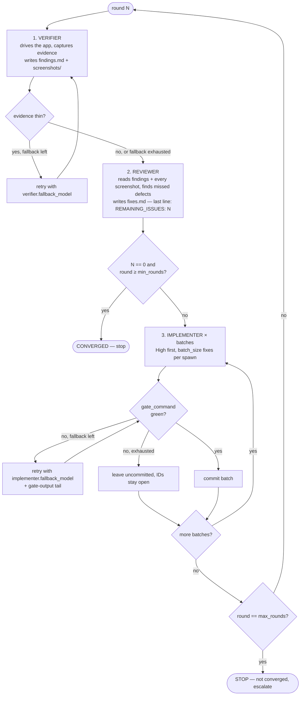

# SDLC — `/sdlc verify-fix-loop`

> Read [`SKILL.md`](./SKILL.md) first for config discovery and the runner table, then [`PHASES.md`](./PHASES.md) § Spawn rules.
> This file is the full rule set for the verify → review → plan-fix → implement → gate loop.

- `verify-fix-loop` is a **subcommand**, like `report` — it is **not** a phase token and never a chain member.
- It is not phase scoping (that is what chains are for): it is an outer loop that *repeats* a fixed inner sequence until a reviewer says nothing is left.
- It never reads or writes `phase_chain`.
- Hyphenated and starting with the phase token `verify`, so it **must** be matched as a subcommand before the `+`/`-` split, or it would parse as the segments `verify`, `fix`, `loop`.

```
/sdlc verify-fix-loop [<feature>] [--min=N] [--max=N] [--start=N] [--reuse] [--yes]
```

---

## The loop



| # | Role | Reads | Writes | May edit source? |
|---|------|-------|--------|:---:|
| 1 | **Verifier** | app, `design_refs`, standing issues, user feedback, CUJs | `round-N/findings.md`, `round-N/screenshots/` | ❌ |
| 2 | **Reviewer** (also the fix planner) | `findings.md`, **every** screenshot, `design_refs`, standing issues, user feedback, prior rounds' `fixes.md` | `round-N/fixes.md` | ❌ |
| 3 | **Implementer** | `fixes.md` (its batch only), `findings.md`, screenshots | source + tests | ✅ batch only |

- The orchestrator (this agent) owns **all** VCS operations, the gate, the state file, and the spawn/watchdog — no role does
- **Reviewer and fix-planner are one role, one spawn.** The agent that just looked at the images writes the fix list; a separate planner would only see the reviewer's summary of them and lose the visual detail the fixes cite. There is deliberately no `planner` role or config key
- The verifier is **observation only**: findings are facts with evidence, never fixes
- `fixes.md` is the contract with the implementer — it must be self-contained per the `planning` skill's self-containment bar, scaled down to a fix list

---

## Config — `sdlc.verify_fix_loop`

Canonical schema: [`vibekit.example.yaml`](../../vibekit.example.yaml). Subset:

```yaml
sdlc:
  verify_fix_loop:
    min_rounds: 3          # never converge before this round, even at REMAINING 0
    max_rounds: 5          # hard stop → "not converged"
    batch_size: 5          # fixes per implementer spawn
    gate_command: "<project build + test command>"   # REQUIRED — no default
    design_refs: []        # paths the verifier + reviewer compare against
    standing_issues: []    # known issues re-checked EVERY round
    cujs: []               # critical user journeys the verifier must run, PASS/FAIL each
    min_screenshots: 8     # minimum screenshots for a verifier pass to count as non-thin
    agents:
      verifier:    {model: sonnet, fallback_model: sonnet, capture: screenshots, time_limit_min: 50}
      reviewer:    {model: opus,   time_limit_min: 25}
      implementer: {model: sonnet, fallback_model: opus, parallel: false, time_limit_min: 50}
```

- `model` is whatever the runner resolves: a model name in-harness, or a mode id under a meta-harness
- `gate_command` unset → **STOP before round 1** and ask; never guess a project's build/test command
- Each role's `run_in` is honored per [`SKILL.md`](./SKILL.md) § Runner; **the verifier and reviewer default to `in-harness` unless the user sets otherwise** — a long unattended loop usually wants `meta-harness` for all three so the loop survives the parent session
- `time_limit_min` is a **watchdog**: past it, capture the role's output, terminate it, and treat the step as failed (→ fallback). Defaults: verifier 50, reviewer 25, implementer 50

### Standing issues and feedback files

- `standing_issues` plus every file matching `<loop_dir>/user-feedback*.md` are concatenated and injected **verbatim** into the verifier and reviewer prompts, **re-read at the start of every round** — the user can drop a feedback file mid-loop and it lands next round
- `<loop_dir>/owner-extra-round<N>.md`, if present, is appended to round N's `fixes.md` **after** the reviewer finishes (once — skip if its marker heading is already there), and `REMAINING_ISSUES` is recomputed to include it

---

## Artifact layout

```
.vibekit/reports/verify-fix-loop/<slug>/        ← <loop_dir>; slug = feature name or `app`
  .loop-state.yaml                          ← resume anchor (below)
  user-feedback*.md                         ← optional, user-written
  round-N/
    findings.md       verifier
    fixes.md          reviewer — last line `REMAINING_ISSUES: <int>`
    screenshots/      transient by default (gitignored), per `screenshots.policy`
```

- Under `.vibekit/reports/` but per-round files are **written once by their role and never edited in place** — a re-run of a step replaces the file wholesale; the prior one is not kept
- `screenshots.policy: permanent` is the only way screenshots are committed; the loop never narrows `.vibekit/.gitignore` itself

### `.loop-state.yaml`

```yaml
loop: app
worktree: /path/to/checkout      # same wrong-worktree guard as .sdlc-state.yaml
round: 2
step: implement                  # verify | review | implement | done
batches:                         # per-round, in order
  - {ids: [R2F-01, R2F-02], status: committed, commit: abc1234}
  - {ids: [R2F-03],         status: open}          # gate stayed red
remaining: 7                     # from the last fixes.md
last_remaining: [12, 7]          # per round — stall detection
permissions: {commit: batch, device: "<serial>"}   # granted at start, see below
```

- Resume (`/sdlc verify-fix-loop` again, or `--start=N`) reads this file and continues at `step`; completed steps are **never** re-run — same rule as M2's "never redo `[x]`"
- `--reuse` additionally accepts an existing non-empty `findings.md` / `fixes.md` for the round instead of regenerating it (for editing a report by hand, then continuing)
- Batch IDs already `committed` are skipped; `open` IDs re-enter the next batch list, High first
- `.loop-state.yaml` is orchestrator-owned — implementers must not touch it

---

## Permissions — asked once, up front

Autonomous loops cannot ask per step, and the repo's VCS rule is "never commit without permission". So, **once, before round 1**, ask and persist the answer in `permissions`:

| Question | Why | Skipped when |
|----------|-----|--------------|
| Commit source once per green batch? (`chore(sdlc): verify-fix-loop <slug> r<N> batch <M> (<ids>)`) | Same standing-grant shape as the `mode: turn` carve-out in `PHASES.md` § Commit rules | answer already in `.loop-state.yaml` |
| Which device / emulator serial may the verifier use? | Devices are shared — never seize (`PHASES.md` § Verify) | project has no device UI (`verifier.capture: none`) |
| Is `<gate_command>` correct? | A wrong gate silently commits broken code | `--yes` was passed |

- Answer "no" to commit → batches stay uncommitted and the loop **pauses after batch 1's gate** (`awaiting_phase: implement`), since later batches would pile onto an unreviewed tree
- The verifier prompt names the **only** device it may touch and tells it to write "device busy/absent" in `findings.md` and stop if it can't — never fall back to another device
- A verifier prompt must also say: restore every device setting it changed (overlays, font scale, density, orientation)

---

## Step rules

### 1. Verify

- Prompt = role + repo + device/serial + standing issues + `cujs` + `design_refs` + output spec (`findings.md` table: id, severity High/Med/Low, screen/CUJ, expected (cite ref), actual, screenshot file, suspected file/area; plus CUJ PASS/FAIL table; a ≤5-line summary)
- Verifier is told to quantify (numbers from UI dumps, not "looks off") — the reviewer judges the images later, not the verifier
- **Thin-evidence check** after the spawn: `screenshots ≥ min_screenshots` (default 8) **and** `findings.md ≥ 20 lines`; else retry once with `verifier.fallback_model`, then continue with whatever exists and say so — the reviewer's independent pass is the backstop
- No `findings.md` at all → record `no findings produced`, still run review (it can inspect screenshots alone)

### 2. Review + plan fixes

- Reviewer reads **every** image with the Read tool — "I read findings.md" is not review; the prompt says to actually look
- It checks for what the verifier cannot see: clipping, overlap, contrast, truncation, touch-target size, spacing/typography drift against `design_refs`, wrong copy
- It checks whether **earlier rounds' fixes actually worked** by comparing to prior `fixes.md` — a regression is a new, High finding
- `fixes.md` per fix: `### <ID> [High|Med|Low]` heading, problem (with screenshot ref), exact expected behavior (cite ref), concrete change (paths, symbols), acceptance check (a test where possible, else the exact repro/screenshot check)
- Grouped by file so one implementer can work it top-down; a **Do NOT change** list of things verified OK
- **Last line exactly `REMAINING_ISSUES: <integer>`** — 0 only if nothing is left to fix. Missing/malformed → `unknown`, which is treated as non-zero
- Reviewer produced no `fixes.md` → retry once with `implementer.model` before declaring the step failed

### 3. Implement (batched)

- Parse `### <ID> [<sev>]` headings; sort High → Med → Low, then by number; drop IDs already `committed`; chunk by `batch_size`
- One fresh implementer per batch, with this prompt contract (**non-negotiable, ship verbatim in spirit**):
  - Read `coding-agent-guardrails`, then `coding` (+ `android-coding` on Kotlin/Compose) before touching any file
  - Implement **only** the batch's IDs, completely — no stubs, no TODO-as-implementation, no `@Ignore`d or weakened tests, no demo-only branches in production paths
  - **No `git add/commit/stash/reset/checkout`** — the orchestrator owns VCS
  - Do not edit `.loop-state.yaml`, `.sdlc-state.yaml`, or anything under `<loop_dir>/` (the reports are read-only inputs)
  - No drive-by refactors, renames, or dependency bumps
  - Ambiguous or contradicts a design ref → **stop and report** the fix id and the question; never invent
  - Run `gate_command` before finishing and fix every error it introduced
  - Final answer: per-fix `done | not-done | needs-decision` with files touched
- `needs-decision` from any fix → that ID stays open, is surfaced in the round report, and the batch still proceeds for the rest
- Optional `implementer.parallel: true` lets the implementer fan out in-harness subagents by file/module; they inherit the same contract

### Gate and commit

- After each batch the **orchestrator** runs `gate_command` — never trust the implementer's "green"
- Red or **no source diff** → respawn once with `implementer.fallback_model`, prompt = original task + the failing gate's output tail (≈3.5 KB)
- Still red → **leave the changes uncommitted**, mark the batch `open`, say so, continue to the next batch. Do not `git checkout` the tree clean — a human may want the partial work
- Green and diff non-empty → stage only the batch's source paths (never `.gitignore`), commit with the prefix above; `.loop-state.yaml` and the round reports commit separately under the `.vibekit/` carve-out
- Batches run **sequentially** — one working tree, one gate at a time

---

## Stop conditions

| Condition | Result |
|-----------|--------|
| `REMAINING_ISSUES: 0` and `round ≥ min_rounds` | **converged** — commit the round's reports (`.vibekit/` carve-out), `step: done`, report |
| `round == max_rounds`, not converged | **STOP** — report remaining count + open IDs; ask: raise `--max`, accept, or park |
| `remaining` unchanged for 2 consecutive rounds (`stall`) | **STOP and ask** — the loop is not making progress; never burn more rounds silently |
| `gate_command` red twice on the same batch in two rounds | **STOP and ask** — likely a bad fix list, not a bad implementer |
| Usage/rate limit text in a role's output | sleep until the stated reset (cap 6 h), retry the **same step**, max 6 times, then stop |
| Verifier can't reach the device | write that in `findings.md`, run reviewer on whatever exists, **do not** pick another device |
| User interrupt / new session | state is already on disk — `/sdlc verify-fix-loop` resumes at `step` |

- Every stop writes `.loop-state.yaml` **before** reporting, same rule as M9
- A converged-too-early guard: `REMAINING 0` at `round < min_rounds` runs the next round anyway — one clean pass can be a thin verifier

---

## Interaction with the rest of `/sdlc`

- Independent of `.sdlc-state.yaml` — a loop can run against a feature that's `done`, mid-implement, or has no sdlc state at all
- A named feature's `.sdlc-state.yaml` is never edited from inside the loop; if its `mode` looks stale relative to the result, say so once in the final report
- Doesn't touch `awaiting_*` on any sub-feature — read-only with respect to the pause lifecycle, like `report`
- Reviewer `gate: user` is **not** consulted: this loop's reviewer is part of the loop body, not an artifact gate. The only human stops are the up-front permissions and the stop conditions above
- Final report (chat, ≤15 lines): rounds run, per-round `remaining`, commits, open IDs, converged yes/no, path to `<loop_dir>`

---

## Generifying checklist (for a new project)

| Slot | In the original mobile loop | Set via |
|------|-----------------------------|---------|
| Device + driver | Pixel via `adb` + `uiautomator` | `verifier` prompt, `permissions.device`; any driver (Playwright, simulator, curl) works |
| Evidence | screenshots + UI dumps | `verifier.capture: screenshots \| logs \| none` |
| Design truth | HTML frames | `design_refs` |
| Product owner rules | numbered standing issues | `standing_issues`, `user-feedback*.md` |
| Build/test gate | Gradle target list | `gate_command` |
| Models | Sonnet verify, Opus review, Sonnet implement | `agents.*.model` |
